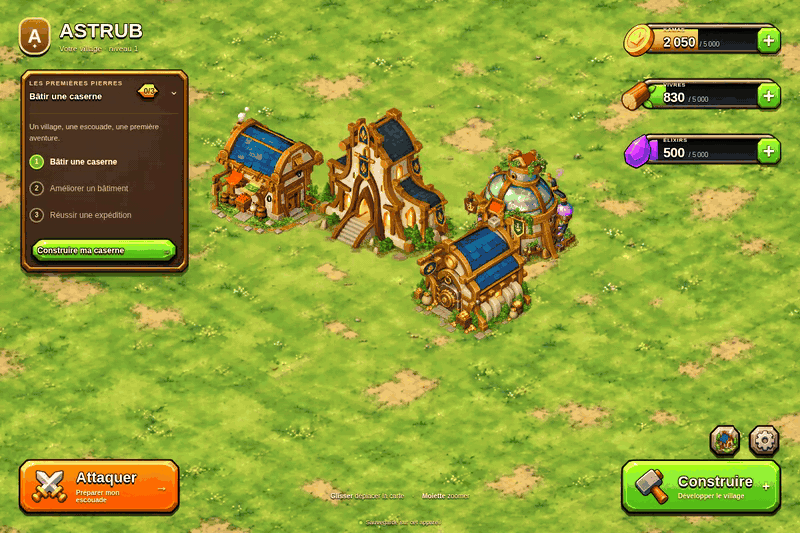

# Astrub — Les premières pierres · v0.8.0

[**Télécharger Astrub v0.8.0 — ZIP complet**](https://github.com/tfortun-dev/test/raw/refs/heads/main/astrub/downloads/Astrub-v0.8.0.zip)

Le ZIP contient le code source, les atlas prêts à l'emploi, la version compilée et les aperçus. Aucun export graphique n'est requis pour jouer. Pour développer depuis ce dépôt : `cd astrub`, puis `npm ci` et `npm run dev`.

[Télécharger le pack ART v0.8.0 — sources et outils graphiques](https://github.com/tfortun-dev/test/raw/refs/heads/main/astrub/downloads/Astrub-art-v0.8.0.zip) : pack facultatif pour rééditer les planches et réexporter les sprites. Le dépôt conserve aussi ces sources ; elles sont séparées du ZIP du jeu pour limiter son poids.


Prototype local de gestion de village isométrique : récolter, construire, améliorer, former des Iops et des Crâs, puis attaquer un camp de bandits. La v0.8.0 remplace les dessins de personnages par des sprites peints et anime les bâtiments avec des suites de poses. La palette et les références viennent des bâtiments fournis pour le projet. Les règles et la sauvegarde sont conservées.

## Jouer sous Windows

1. Extraire le ZIP et ouvrir `Astrub-v0.8.0`.
2. Installer **Node.js LTS** si nécessaire : https://nodejs.org/ (Node 20.19+ ou 22.12+ conseillé).
3. Double-cliquer sur `DEMARRER_WINDOWS.bat`. Le premier lancement télécharge les dépendances.
4. Garder le terminal ouvert. Le navigateur s'ouvre sur `http://127.0.0.1:5173/` quand le serveur est prêt.

Le lanceur Windows est fourni ; son exécution native n'a pas été testée sur cette machine Linux.

**Retrouver une ancienne partie :** utiliser le même navigateur, le même profil et exactement la même adresse `http://127.0.0.1:5173/`. La clé `astrub_village_local_v1` et le format de sauvegarde sont conservés. Extraire cette version dans un nouveau dossier évite d'écraser vos anciens fichiers. Une partie reste stockée dans le navigateur, pas dans le ZIP.

## Développer sous Linux, macOS ou Windows

```sh
npm ci
npm run dev
```

Le serveur utilise le port fixe 5173. Si une ancienne version occupe ce port, arrêter son terminal avant de lancer celle-ci.

```sh
npm test       # logique du village, migrations, rendu et préparation d'expédition
npm run build # compilation de production
npm run preview -- --port 5173 --strictPort
```

`dist/` est produit par le build. Ce ZIP contient aussi une version compilée dans `dist/`. Pour l'essayer sans installer les dépendances, si Python 3 est disponible : `python -m http.server 5173 --bind 127.0.0.1 --directory dist`, puis ouvrir la même adresse locale. `dist/index.html` doit être servi par HTTP ; un double-clic sur le fichier HTML ne lance pas le jeu.

Pour préparer une livraison après vérification du jeu : `python3 tools/package_release.py`. Le script contrôle la version et les résultats du rapport, puis génère les deux ZIP dans `downloads/`. Chaque archive utilise le dossier `Astrub-v0.8.0`.

## Ce qui change dans la v0.8.0

- Sprites peints pour les villageois, poules, lapins, Iops et Crâs. Les passants gardent leurs petits trajets décoratifs autour des bâtiments.
- Marche en quatre poses et quatre orientations ; les troupes disposent aussi d'une courte séquence d'attaque. Le repos peut conserver une même image.
- Six bâtiments animés en quatre poses, avec une boucle lente ; leur ancrage, leur taille et leur zone de sélection restent fixes.
- Huit illustrations de décor peintes dans la même direction artistique.
- Portraits, cartes de construction et placement utilisent une pose fixe issue des mêmes exports.
- Images éditées avec `image_gen`, puis découpées et normalisées en atlas PNG. Le jeu affiche ces images 2D ; il ne calcule pas de scène 3D en temps réel.

Les interfaces, jauges et fonctions précédentes restent présentes : capacités, catégories **Production / Stockage / Armée**, fiche de caserne, trois objectifs, préparation d'expédition et commandes clavier. Les passants restent décoratifs. Les bâtiments gardent la même façade à tous les niveaux ; cette version n'ajoute pas de construction visuelle par palier.

Le détail figure dans [CHANGELOG-v0.8.0.md](CHANGELOG-v0.8.0.md). [ART_PIPELINE.md](ART_PIPELINE.md) décrit les exports ; [UI_ARCHITECTURE.md](UI_ARCHITECTURE.md) décrit l'intégration et les calques.

## Aperçus

[Village animé](APERCUS/Village-anime.gif) · [Village](APERCUS/Village.png) · [Construction](APERCUS/Construction.png) · [Actions de bâtiment](APERCUS/Actions.png) · [Expédition sur mobile](APERCUS/Expedition-mobile.png) · [Calques de l'interface](APERCUS/Calques.png)

[Planches des troupes](APERCUS/Sprites-troupes.png) · [Passants](APERCUS/Sprites-passants.png) · [Bâtiments](APERCUS/Sprites-batiments.png) · [Décors](APERCUS/Sprites-decors.png)



## Commandes

- Cliquer sur un producteur récolte sa réserve et ouvre ses actions.
- Le **+** d'une ressource ouvre la catégorie Production et indique le bâtiment correspondant ; il ne donne pas de ressources.
- **Construire** : choisir un bâtiment puis une case libre. Le menu se replie pendant le placement.
- **Déplacer** : déplacement gratuit, sans perdre niveau ni réserves. Vert = libre ; rouge = occupé ou hors carte.
- **Valider** ou **Entrée** : confirmer l'emplacement visé ; **Échap** : fermer une fenêtre ou annuler une action.
- Glisser la carte / **ZQSD ou WASD** : déplacer la caméra. **Molette** : zoomer. **H** ou le bouton maison : recentrer.
- **Bouton Infos** : fiche détaillée. Pour une caserne, la fiche s'ouvre directement.
- **Attaquer** : préparer l'expédition ; en combat, choisir une classe puis cliquer dans la zone claire.

## Vérification et limites

Les commandes de vérification et le parcours Chromium sont décrits dans [VERIFICATION.md](VERIFICATION.md). Le rapport [RESULTATS_VERIFICATION.json](RESULTATS_VERIFICATION.json) indique la version contrôlée et les résultats des tests.

Le combat reste une **démonstration locale** : aucune riposte ennemie, aucune perte de PV et aucune défaite naturelle. Les unités déployées sont dépensées à la fin, y compris en cas d'abandon ; les unités non déployées sont conservées. Pas de compte, de serveur de jeu ou de multijoueur dans cette version.

Lire **[SUITE_DU_PROJET.md](SUITE_DU_PROJET.md)** pour la prochaine étape : progression réelle, camps capables de riposter, campagne puis sauvegarde en ligne.
