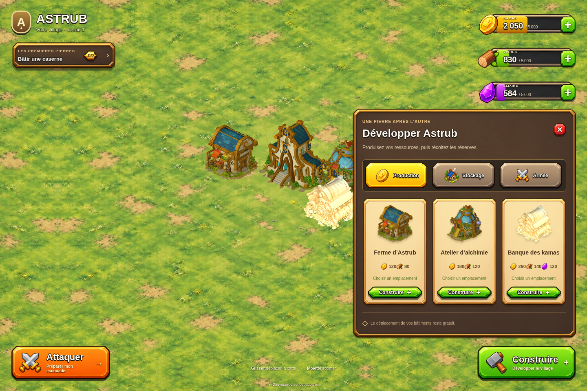

# Astrub — Les premières pierres · v0.7.1

[**Télécharger Astrub v0.7.1 — ZIP complet**](https://github.com/tfortun-dev/test/raw/refs/heads/main/astrub/downloads/Astrub-v0.7.1.zip)

Le ZIP contient les sources, la version compilée et les aperçus. Pour développer depuis ce dépôt : `cd astrub`, puis `npm ci` et `npm run dev`.


Prototype local de gestion de village isométrique : récolter, construire, améliorer, former des Iops et des Crâs, puis attaquer un camp de bandits. La v0.7.1 rapproche les interfaces de la planche illustrée du projet : boutons en relief, couleurs franches, cadres bruns et jauges sombres. Les cartes, bâtiments, sprites et règles du village sont conservés.

## Jouer sous Windows

1. Extraire le ZIP et ouvrir `Astrub-v0.7.1`.
2. Installer **Node.js LTS** si nécessaire : https://nodejs.org/ (Node 20.19+ ou 22.12+ conseillé).
3. Double-cliquer sur `DEMARRER_WINDOWS.bat`. Le premier lancement télécharge les dépendances.
4. Garder le terminal ouvert. Le navigateur s'ouvre sur `http://127.0.0.1:5173/` quand le serveur est prêt.

Le lanceur Windows est fourni ; son exécution native n'a pas été testée sur cette machine Linux.

**Retrouver une ancienne partie :** utiliser le même navigateur, le même profil et exactement la même adresse `http://127.0.0.1:5173/`. La clé `astrub_village_local_v1` et le format de sauvegarde sont conservés. Extraire cette version dans un nouveau dossier évite d'écraser vos anciens fichiers. Une partie reste stockée dans le navigateur, pas dans le ZIP.

## Développer sous Linux, macOS ou Windows

```sh
npm ci
npm run dev
```

Le serveur utilise le port fixe 5173. Si une ancienne version occupe ce port, arrêter son terminal avant de lancer celle-ci.

```sh
npm test       # logique du village, migrations, rendu et préparation d'expédition
npm run build # compilation de production
npm run preview -- --port 5173 --strictPort
```

`dist/` est produit par le build. Ce ZIP contient aussi une version compilée dans `dist/`. Pour l'essayer sans installer les dépendances, si Python 3 est disponible : `python -m http.server 5173 --bind 127.0.0.1 --directory dist`, puis ouvrir la même adresse locale. `dist/index.html` doit être servi par HTTP ; un double-clic sur le fichier HTML ne lance pas le jeu.

## Ce qui change dans la v0.7.1

- Boutons avec biseau épais et relief, déclinés en vert, orange, bleu, or, rouge et taupe selon leur rôle.
- Cadres bruns, panneaux sombres, cartes de parchemin et jauges sombres pour une interface plus proche du village illustré.
- Même famille visuelle sur la construction, les actions de bâtiment, les objectifs, les réglages, l'aide et les expéditions.
- Textures et icônes séparées du texte, avec des cadres extensibles qui conservent leurs coins et leurs biseaux. Coûts et compteurs restent en HTML.
- Bouton **Valider** pour confirmer l'emplacement choisi lors d'une construction ou d'un déplacement, en complément d'Entrée.
- Boutons **+** des ressources qui ouvrent les producteurs correspondants ; confirmation de nouvelle partie dans une fenêtre assortie au jeu.
- Réinitialisation protégée des callbacks d'un ancien raid ; effectifs de combat actualisés lorsqu'une formation se termine.

Les fonctions de la v0.7.0 restent présentes : capacités de ressources, catégories **Production / Stockage / Armée**, raisons d'indisponibilité, fiche de caserne, guide de trois objectifs, préparation d'expédition et commandes clavier. Le guide n'ajoute pas de récompense ; la partie garde le même format de sauvegarde.

Le détail de cette refonte figure dans [CHANGELOG-v0.7.1.md](CHANGELOG-v0.7.1.md). Pour faire évoluer ses composants, lire [UI_ARCHITECTURE.md](UI_ARCHITECTURE.md).

## Aperçus

[Village](APERCUS/Village.png) · [Construction](APERCUS/Construction.png) · [Actions de bâtiment](APERCUS/Actions.png) · [Expédition sur mobile](APERCUS/Expedition-mobile.png) · [Calques de l'interface](APERCUS/Calques.png)



## Commandes

- Cliquer sur un producteur récolte sa réserve et ouvre ses actions.
- Le **+** d'une ressource ouvre la catégorie Production et indique le bâtiment correspondant ; il ne donne pas de ressources.
- **Construire** : choisir un bâtiment puis une case libre. Le menu se replie pendant le placement.
- **Déplacer** : déplacement gratuit, sans perdre niveau ni réserves. Vert = libre ; rouge = occupé ou hors carte.
- **Valider** ou **Entrée** : confirmer l'emplacement visé ; **Échap** : fermer une fenêtre ou annuler une action.
- Glisser la carte / **ZQSD ou WASD** : déplacer la caméra. **Molette** : zoomer. **H** ou le bouton maison : recentrer.
- **Bouton Infos** : fiche détaillée. Pour une caserne, la fiche s'ouvre directement.
- **Attaquer** : préparer l'expédition ; en combat, choisir une classe puis cliquer dans la zone claire.

## Vérification et limites

Les commandes de vérification et le parcours Chromium sont décrits dans [VERIFICATION.md](VERIFICATION.md). Le rapport [RESULTATS_VERIFICATION.json](RESULTATS_VERIFICATION.json) indique la version contrôlée et les résultats des tests.

Le combat reste une **démonstration locale** : aucune riposte ennemie, aucune perte de PV et aucune défaite naturelle. Les unités déployées sont dépensées à la fin, y compris en cas d'abandon ; les unités non déployées sont conservées. Pas de compte, de serveur de jeu ou de multijoueur dans cette version.

Lire **[SUITE_DU_PROJET.md](SUITE_DU_PROJET.md)** pour la prochaine étape : progression réelle, camps capables de riposter, campagne puis sauvegarde en ligne.
